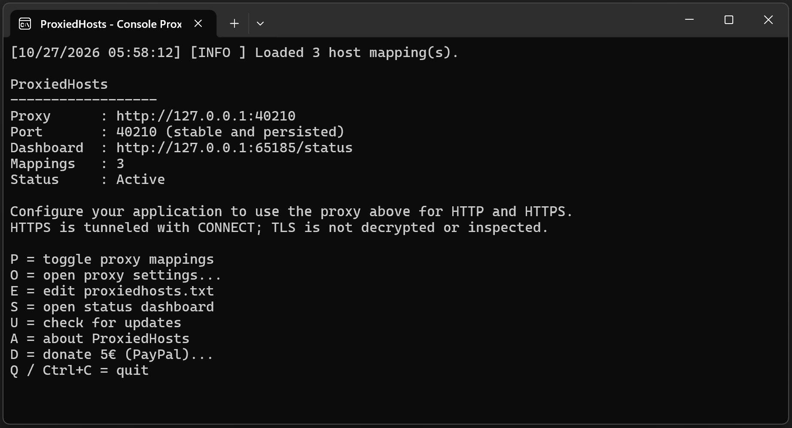
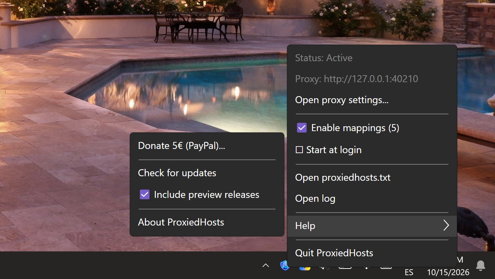
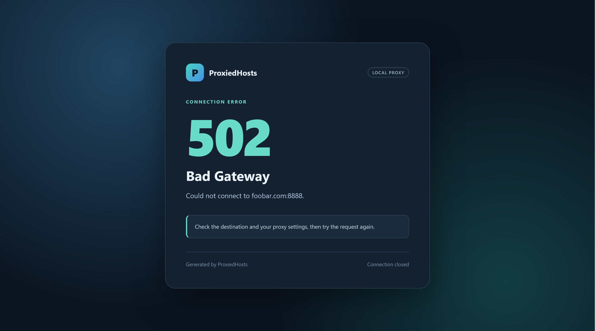
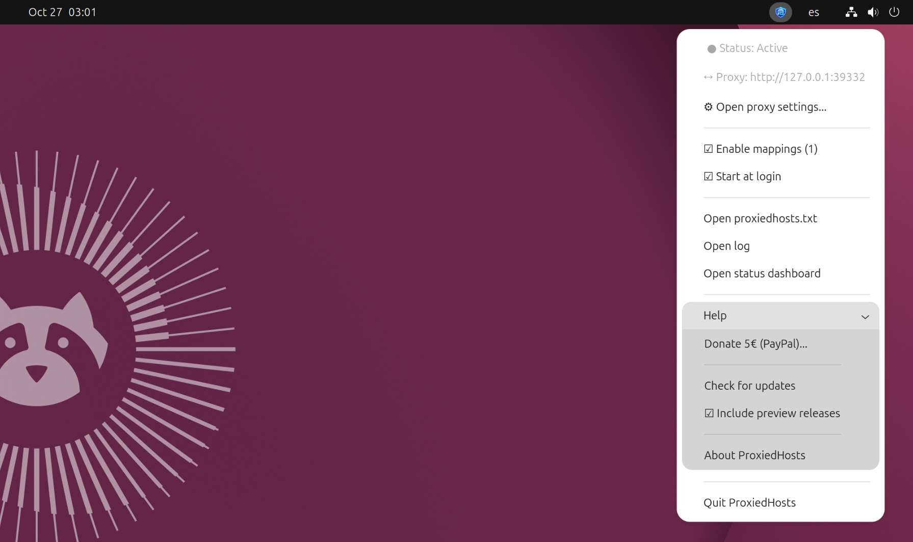
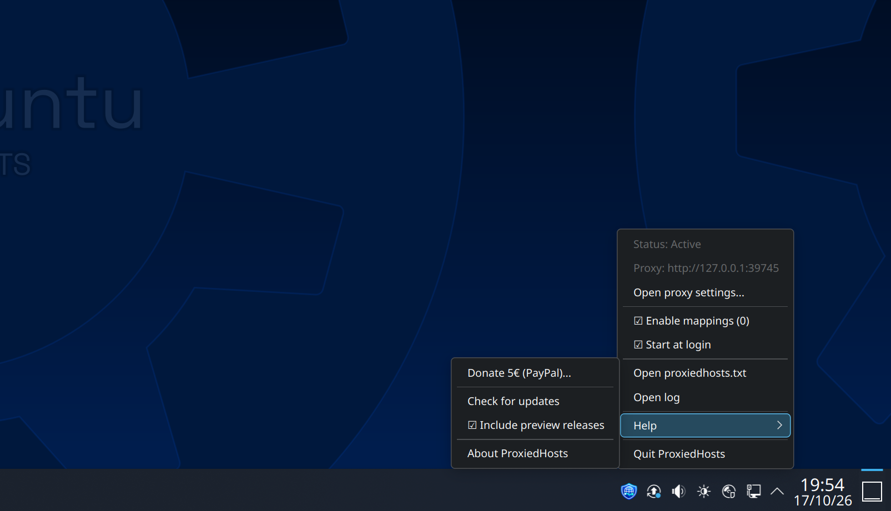
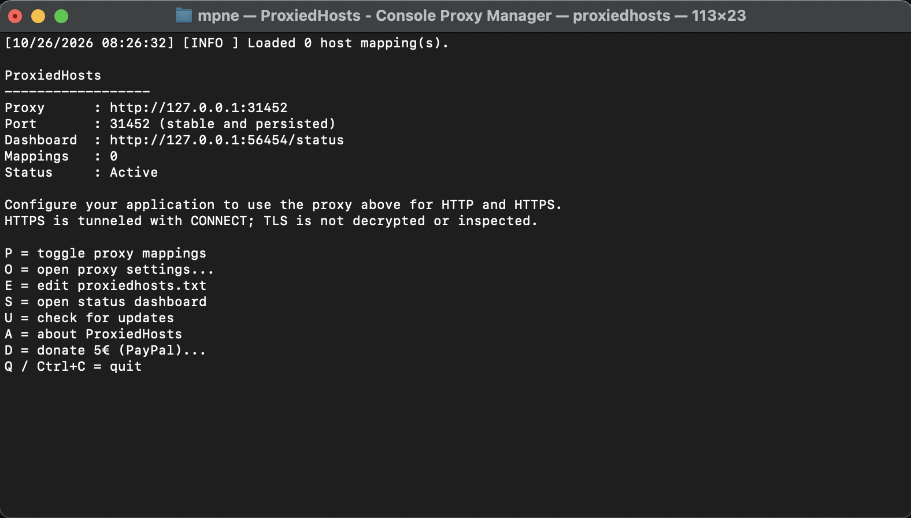
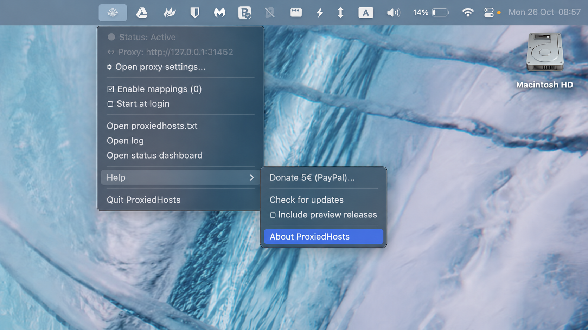
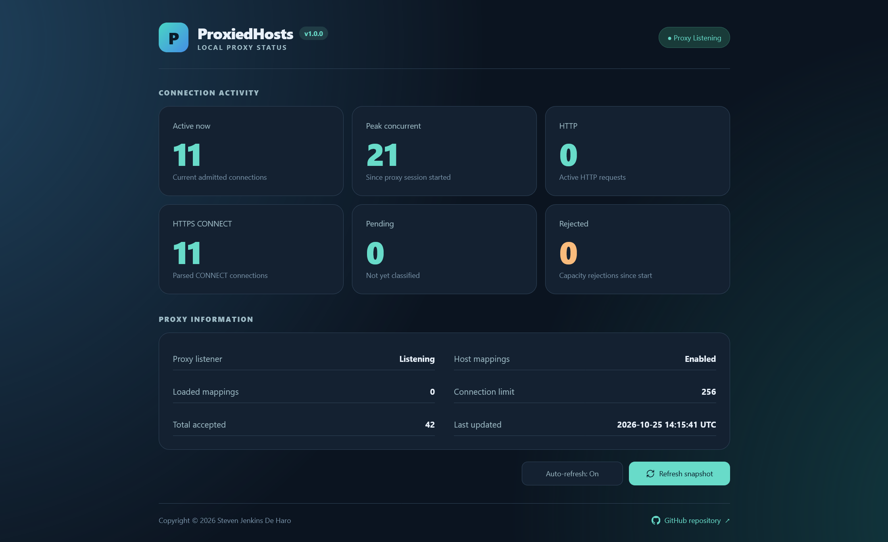

# ProxiedHosts

[](https://github.com/StevenJDH/ProxiedHosts/actions/workflows/dotnet-build-workflow.yml)


[](https://app.codacy.com/gh/StevenJDH/ProxiedHosts/dashboard?utm_source=gh&utm_medium=referral&utm_content=&utm_campaign=Badge_grade)
[](https://sonarcloud.io/summary/new_code?id=StevenJDH_ProxiedHosts)
[](https://sonarcloud.io/summary/new_code?id=StevenJDH_ProxiedHosts)
[](https://sonarcloud.io/summary/new_code?id=StevenJDH_ProxiedHosts)
[](https://sonarcloud.io/summary/new_code?id=StevenJDH_ProxiedHosts)
[](https://sonarcloud.io/summary/new_code?id=StevenJDH_ProxiedHosts)
[](https://sonarcloud.io/summary/new_code?id=StevenJDH_ProxiedHosts)
[](https://sonarcloud.io/summary/new_code?id=StevenJDH_ProxiedHosts)
[](https://sonarcloud.io/summary/new_code?id=StevenJDH_ProxiedHosts)


ProxiedHosts is a lightweight local HTTP and HTTPS proxy for applying custom hostname-to-IP mappings without modifying the system hosts file. Mappings are loaded from a simple `proxiedhosts.txt` file that can be changed without administrator privileges. HTTP traffic is forwarded using the configured hostname mappings, while HTTPS connections are tunneled using the standard CONNECT method without decrypting TLS traffic. A stable local proxy port is generated and persisted between application launches for predictable client configuration. The proxy is designed primarily for local development, testing, and environments where editing the operating system hosts file is inconvenient or restricted.

<table>
  <tr>
    <td align="center">
      <br>
      <b>Console App</b><br>
      Console proxy manager.
    </td>
    <td align="center">
      <br>
      <b>Tray App</b><br>
      Desktop proxy manager.
    </td>
    <td align="center">
      <br>
      <b>HTML Errors</b><br>
      HTTP proxy errors.
    </td>
  </tr>
  <tr>
    <td align="center">
      <br>
      <b>GNOME Desktop</b><br>
      Ubuntu Desktop Environment.
    </td>
    <td align="center">
      <br>
      <b>KDE Plasma</b><br>
      Kubuntu Desktop Environment.
    </td>
    <td align="center">
      <br>
      <b>macOS Terminal</b><br>
      Universal binary support.
    </td>
  </tr>
  <tr>
    <td align="center">
      <br>
      <b>macOS Menu Bar</b><br>
      Native look & feel.
    </td>
    <td align="center">
      <br>
      <b>Status Dashboard</b><br>
      Proxy activity monitoring.
    </td>
    <td align="center">
      <a href="./screenshots/">More...</a>
    </td>
  </tr>
</table>

[](https://www.buymeacoffee.com/stevenjdh)

## Features

* Native AOT compilation for fast startup, low memory usage, and no .NET runtime dependency.
* Supports HTTP proxying and HTTPS tunneling via `CONNECT` without TLS interception or custom root certificates.
* No administrator privileges or system hosts-file modifications required.
* Custom hostname-to-IP mappings with optional port redirection using a familiar hosts-file-style format.
* Uses normal DNS resolution for unmapped hosts.
* Toggle proxy state to enable traffic passthrough without stopping the proxy.
* Hot-reloads `proxiedhosts.txt`, ignoring invalid entries and preserving mappings on failure.
* Disconnects only connections affected by mapping changes.
* Binds exclusively to `127.0.0.1` for local access.
* Generates a random port on first run and persists it for subsequent runs.
* [Status dashboard](#status-dashboard) with connection statistics and other operational info.
* Optionally starts the tray application at system login.
* Automatic and manual update checking with option for preview releases.
* Automatically closes idle connections without network activity.
* Enforces timeouts for incoming HTTP headers and upstream connection attempts.
* Gracefully shuts down active connections before forcing them to close.
* Prevents incorrect HTTP connection reuse by enforcing `Connection: close` on requests and responses.
* Preserves tunnel data received alongside `CONNECT` headers to prevent data loss.
* Supports TCP half-close to allow remaining traffic to finish when one direction closes.
* Compliant with `RFC 9110`, `RFC 9112`, and the newer `RFC 9931` where applicable.

## Compatibility
Below is a list of supported platforms for each tool variant.

| Platform   | Console App | Tray App   |
|------------|:-----------:|:----------:|
|  | ✅ | ✅ |
|    | ✅ | ✅ |
|  | ✅ | ✅ |

## Usage
A console application and a system tray/menu bar variant of ProxiedHosts are provided as alternative options. For `proxiedhosts`, run the executable to see the printout of the proxy URL configuration, for example:

```text
Proxy      : http://127.0.0.1:12345
Port       : 12345 (stable and persisted)
```

For `proxiedhosts-tray`, run the executable and right-click the icon in the system tray (or menu bar on macOS) to see the same proxy URL configuration, for example:

```text
┌──────────────────────────────────────┐
│ ● Status: Active                     │
│ ↔ Proxy: http://127.0.0.1:12345      │
│ ⚙ Open proxy settings...            │
├──────────────────────────────────────┤
│ ☑ Enable mappings (5)               │
│ ☑ Start at login                    │
├──────────────────────────────────────┤
│ Open proxiedhosts.txt                │
│ Open log                             │
│ Open status dashboard                │
├──────────────────────────────────────┤
│ Help                               ▸ │   ┌──────────────────────────────────┐
├──────────────────────────────────────┤   │ Donate 5€ (PayPal)...            │
│ Quit ProxiedHosts                    │   ├──────────────────────────────────┤
└──────────────────────────────────────┘   │ Check for updates                │
                                           │ ☐ Include preview releases      │
                                           ├──────────────────────────────────┤
                                           │ About ProxiedHosts               │
                                           └──────────────────────────────────┘
```

With the proxy configuration in hand, configure the client application or system to use that address for both HTTP and HTTPS proxying.

> [!TIP]
> For Linux and macOS, run `chmod +x proxiedhosts` to set the execution bit so that `./proxiedhosts` works for running the application. Also, macOS users will likely need to run `xattr -d com.apple.quarantine proxiedhosts` to remove the quarantine attribute so that it doesn't get block by Gatekeeper. Alternatively, the execution can be approved by going to `System Settings > Privacy & Security`. The same applies for `proxiedhosts-tray`. For Windows, if there is a blue popup, click the `More info` text, and then click the `Run anyway` button. Subsequent runs will not require this.

> [!IMPORTANT]  
> Microsoft Teams for work or school may disconnect when setting the proxy at the system level. To prevent this issue, add `teams.microsoft.com;*.teams.microsoft.com;teams.cloud.microsoft;*.teams.cloud.microsoft;login.microsoftonline.com` to the system proxy exception list. This solution is based on this [Microsoft Tech Community discussion](https://techcommunity.microsoft.com/discussions/teamsdeveloper/when-using-proxy-on-localhost-teams-fails-to-establish-tcp-connection-for-login/4146890), and it aligns with [Microsoft's recommendation](https://learn.microsoft.com/en-us/microsoftteams/proxy-servers-for-skype-for-business-online) for bypassing proxy servers for Teams traffic.

### Proxy port generation
On first run, the application selects an unused port in the range `20000-45000` and writes it to:

* Windows: `%LOCALAPPDATA%\ProxiedHosts\proxy.port`.
* Other platforms: the .NET local-application-data location for the current user.

On later runs, the same port is reused. If another process is already using that port, the proxy exits with an error instead of silently changing ports. Delete `proxy.port` if a new port is needed.

### Technical test
To test the proxy for a couple of features, add `127.0.0.1 example.com` to the proxiedhosts.txt file. Then run the following command after updating `--proxy` with the actual proxy port:

```bash
# The empty '--noproxy' value guarantees curl won't bypass the proxy because of `NO_PROXY` and `no_proxy`environment variables.
curl http://example.com \
    --noproxy "" \
    --proxy http://127.0.0.1:12345  \
    -H "Connection: keep-alive" \
    -H "Proxy-Connection: keep-alive" \
    -v
```

🔳 **Output:**

```bash
*   Trying 127.0.0.1:12345...
* Established connection to 127.0.0.1 (127.0.0.1 port 12345) from 127.0.0.1 port 63840
* using HTTP/1.x
> GET http://example.com/ HTTP/1.1
> Host: example.com
> User-Agent: curl/8.21.0
> Accept: */*
> Proxy-Connection: keep-alive
> Connection: keep-alive
>
* Request completely sent off
< HTTP/1.1 502 Bad Gateway
< Content-Type: text/html; charset=utf-8
< Content-Length: 4022
< Cache-Control: no-store
< X-Content-Type-Options: nosniff
< Connection: close
<
<!DOCTYPE html>
<html lang="en">
<head>
    <meta charset="utf-8">
    <meta name="viewport" content="width=device-width, initial-scale=1">
    <title>502 Bad Gateway | ProxiedHosts</title>
...
</head>
<body>
    <main class="card">
...
        <p class="message">Could not connect to example.com:80.</p>
...
    </main>
</body>
</html>
* shutting down connection #0
```

The above output demonstrates two important features. One, the part that says `Could not connect to example.com:80` means that the entry provided early was used, in this case, to block traffic to `example.com`. And two, the part of the response that says `Connection: close` is a feature specific for HTTP traffic that removes headers like `Proxy-Connection: keep-alive` and `Connection: keep-alive` after being provided in the request to prevent connection reuse and ensure requests reach their intended destinations.

## Mapping file syntax

**Format:** `<ip-address>[:destination-port] <hostname>[:match-port] [hostname2[:match-port] ...]`

The syntax is similar to the operating-system hosts file:

```text
127.0.0.1 myapp.local
192.168.1.50 api.example.com
10.0.0.20 foo.example.com bar.example.com
```

Comments are supported:

```text
192.168.1.50 api.example.com # test environment
```

Additionally, entries with ports are supported, which isn´t possible with the system's host file:

```text
127.0.0.1:8080 myapp.local
192.168.1.50:8443 api.example.com
192.168.1.50:8443 api.example.com:443
127.0.0.1:5000 app.local:80 api.local:8080
[::1]:8080 ipv6.example.com
```

> [!IMPORTANT]  
> Port numbers must be in the range of 1-65535 inclusively to be valid.

### File location
The application has options to open the `proxiedhosts.txt` file directly, but below are the locations where the file is generated on first run:

| Operating System | Location                                                                             |
|------------------|--------------------------------------------------------------------------------------|
| Windows          | %LOCALAPPDATA%\ProxiedHosts\proxiedhosts.txt                                         |
| macOS            | ~/Library/Application Support/ProxiedHosts/proxiedhosts.txt                          |
| Linux            | ~/.local/share/ProxiedHosts/proxiedhosts.txt (or the configured user data directory) |

## Automatic startup
ProxiedHosts supports running at system login to maintain connectivity for applications using the proxy configuration. The below table shows where the startup configuration is set.

| Operating System | Location                                                                                                         |
|------------------|------------------------------------------------------------------------------------------------------------------|
| Windows          | HKEY_CURRENT_USER\Software\Microsoft\Windows\CurrentVersion\Run                                                  |
| macOS            | ~/Library/LaunchAgents/io.github.stevenjdh.proxiedhosts.plist                                                    |
| Linux            | ~/.config/autostart/proxiedhosts-tray.desktop (or the equivalent directory configured through `XDG_CONFIG_HOME`) |

> [!TIP]
> Move the proxiedhosts-tray application to a permanent location before enabling startup at login. Likewise, before removing the application or changing its location, ensure to disable the startup first.

## Connection logging and overriding proxy behavior

The following command-line flags enable additional connection logging and overriding proxy behavior in both the console and tray applications. These flags are useful for troubleshooting connectivity issues without modifying the default configuration.

| Flag                | Description                                                         |
|---------------------|---------------------------------------------------------------------|
| `--log-all`         | Logs all proxied connection destinations, including unmapped hosts. |
| `--log-diagnostics` | Enables detailed HTTPS tunnel diagnostics, including connection lifecycle events, data transfer statistics, timing, disconnections, errors, etc. Automatically enables `--log-all` behavior. |
| `--no-via`          | Disables adding the proxy's `Via` header to forwarded HTTP requests and responses for compatibility. |
| `--max-connections` | Overrides the maximum number of concurrent proxy connections for the current session. Use with a positive integer to set a limit or with `unlimited` to disable it. |

Example usage:

```batch
proxiedhosts.exe --log-all
proxiedhosts-tray.exe --log-diagnostics
proxiedhosts-tray.exe --no-via
proxiedhosts.exe --no-via --log-diagnostics
proxiedhosts.exe --max-connections 1000
proxiedhosts-tray.exe --max-connections unlimited
```

Without either logging flag, the application only logs mapped requests. The `Via` header is enabled by default unless `--no-via` is specified. Flags apply only to the current session. Fully exit the application before relaunching with different flags, or without them to restore normal behavior.

Diagnostic logging records connection metadata, relay activity, and transfer statistics without decrypting or inspecting HTTPS traffic.

### Diagnostic information

When `--log-diagnostics` is enabled, additional connection diagnostics are recorded for both HTTP requests and HTTPS CONNECT tunnels. Detailed tunnel lifecycle events and transfer statistics are specific to HTTPS CONNECT connections.

| Diagnostic                   | HTTP | HTTPS CONNECT | Description |
|------------------------------|:----:|:-------------:|-------------|
| Connection ID                | Errors only | Yes    | Unique identifier assigned to each connection, allowing related diagnostic entries to be correlated. |
| Requested destination        | Yes  | Yes           | Original hostname and port requested by the client. |
| Routing method               | Yes  | Yes           | Indicates whether the destination uses a custom host mapping or normal DNS resolution. |
| Tunnel establishment         | No   | Yes           | Confirms when an HTTPS CONNECT tunnel has been successfully established. |
| Upstream connection failures | No   | Yes           | Records failed connection attempts, including exception details and relevant socket error codes. |
| Relay direction              | No   | Yes           | Identifies traffic flowing from client to upstream or upstream to client, including which direction completed first. |
| Relay outcome                | No   | Yes           | Reports `EOF`, `Canceled`, `Error`, or `Incomplete` for each direction to help identify how data transfer ended. |
| Relay completion time        | No   | Yes           | Elapsed time until each relay direction completes. |
| Tunnel duration              | No   | Yes           | Total elapsed time from relay startup until tunnel closure. |
| Upstream endpoint            | No   | Yes           | Actual remote IP address and port of the established upstream connection, when available. |
| Bytes transferred            | No   | Yes           | Total successfully forwarded bytes in each direction, helping identify asymmetric or stalled traffic. |
| Time since last relay write  | No   | Yes           | Time elapsed since data was last successfully forwarded, or an indication that no relay payload was forwarded. |
| Connection disconnections    | Yes  | Yes           | Records expected I/O, socket, and disposal exceptions, including their type and message, to help diagnose unexpected disconnects. |

## Status dashboard


ProxiedHosts includes a local status dashboard for monitoring connection activity and proxy health at a glance. The dashboard can be opened from the tray menu or using the console's S shortcut, with the data updating whenever the page is refreshed.

The dashboard provides the following information:

| Metric           | Meaning |
|------------------|---------|
| Active now       | All currently admitted client connections. |
| Peak concurrent  | Highest simultaneous connection count since the proxy session started. |
| HTTP             | Active connections classified as ordinary HTTP requests. |
| HTTPS CONNECT    | Active connections classified as CONNECT requests, including tunnels still being established. |
| Pending          | Accepted connections not yet successfully classified as HTTP or CONNECT. |
| Rejected         | Total connections denied because the configured concurrency limit was reached. |
| Total accepted   | Total client connections admitted since the proxy session started. |
| Connection limit | Effective maximum concurrent connection limit, including command-line overrides. Displays `Unlimited` when no limit is configured. |
| Host mappings    | Whether custom hostname mappings are currently enabled or disabled. |
| Loaded mappings  | Current number of loaded hostname mappings. |
| Proxy listener   | Whether the normal proxy listener is listening or stopped. |


The dashboard runs on a separate HTTP listener bound exclusively to 127.0.0.1, ensuring access independently of the normal proxy's connection limit. Access is read-only and limited to aggregate statistics, without exposing destination hostnames or tunneled traffic.

> [!NOTE]
> Browsers such as Chrome and Edge normally bypass system proxies automatically for loopback addresses, so no manual proxy exception is usually required. If an application explicitly routes loopback requests through a proxy, configure it to access the dashboard directly. This ensures the dashboard remains accessible even when the normal proxy reaches its connection limit.

## Limitations
Below is a list of intentional limitations that may or may not be needed in most or all cases.

* HTTP/1.1 pipelining is not supported because it is not worth the effort to identify individual HTTP request boundaries, including request bodies. It's also obsolete, and not used anymore by modern browsers.
* HTTP protocol upgrades are not supported, so unencrypted WebSocket (`ws://`) upgrades won't work, but encrypted WebSocket (`wss://`) connections will work through CONNECT tunneling.

## Disclaimer
ProxiedHosts is distributed in the hope that it will be useful, but WITHOUT ANY WARRANTY; without even the implied warranty of MERCHANTABILITY or FITNESS FOR A PARTICULAR PURPOSE. See the GNU General Public License for more details.

## Contributing
Thanks for your interest in contributing! There are many ways to contribute to this project. Get started [here](https://github.com/StevenJDH/.github/blob/main/docs/CONTRIBUTING.md).

## Do you have any questions?
Many commonly asked questions are answered in the FAQ:
[https://github.com/StevenJDH/ProxiedHosts/wiki/FAQ](https://github.com/StevenJDH/ProxiedHosts/wiki/FAQ)

## Want to show your support?

|Method          | Address                                                                                   |
|---------------:|:------------------------------------------------------------------------------------------|
|PayPal:         | [https://www.paypal.me/stevenjdh](https://www.paypal.me/stevenjdh "Steven's Paypal Page") |
|Cryptocurrency: | [Supported options](https://github.com/StevenJDH/StevenJDH/wiki/Donate-Cryptocurrency)    |


// Steven Jenkins De Haro ("StevenJDH" on GitHub)
